# Relatório — Etapas 8 a 11: Aprimoramento, Testes, Publicação e Reflexão

**Projeto:** SuperLista Pro: lista de compras inteligente (HTML, CSS, JavaScript com ES Modules)
**Repositório:** https://github.com/jao0097/guilhermedevito
**Aplicação publicada:** https://jao0097.github.io/guilhermedevito/

> **Observação sobre a ferramenta:** as etapas abaixo foram feitas com o agente **Claude Code** e não com o Google Antigravity. A Skill usada foi a **`frontend-ultra`** ("Skill de frontend de alto nível para construir interfaces web de produção"), que está instalada na conta. O processo é o mesmo que o enunciado pede: o agente analisa o código, a Skill dá o método e o checklist, e as melhorias são implementadas e verificadas.

---

## Etapa 8 — Aprimoramento da aplicação

### 8.1 Análise geral do código

O agente leu todos os arquivos do projeto: `index.html`, `style.css`, `js/app.mjs`, `js/store.mjs`, `js/parser.mjs`, `js/audio.mjs` e os testes. Depois abriu a aplicação num navegador real (Chromium com Playwright) em 4 larguras de tela: 320 px, 390 px (iPhone 13), 768 px (tablet) e 1280 px (desktop). As capturas de tela foram analisadas junto com o código.

### 8.2 Problemas identificados

Divididos em categorias. A coluna "Como foi achado" mostra se o problema veio da leitura do código, do teste no navegador ou do checklist da Skill.

#### Erros (bugs)

| # | Problema | Como foi achado |
|---|---|---|
| 1 | **Tema "Escuro OLED" ilegível:** os cards dos itens ficavam brancos com texto branco. Os utilitários `dark:` do Tailwind seguiam o tema do *sistema operacional*, e não o tema escolhido no app. | Captura de tela (ver abaixo) |
| 2 | A entrada por voz prometia entender *"2 quilos de tomate"*, mas o parser só aceitava `kg`. Também não entendia "litros", "dúzia", "caixas" nem números por extenso ("dois"). | Leitura do código + teste |
| 3 | "Água sanitária" era classificada como **Bebidas**, porque a palavra "água" era encontrada primeiro. | Teste do parser |
| 4 | **Falha de segurança (XSS):** um arquivo de backup modificado podia injetar HTML/JavaScript na página, porque os IDs entravam no HTML sem tratamento. | Leitura do código |
| 5 | A chuva de confetes disparava toda vez que a página era recarregada com a lista completa. | Leitura do código |
| 6 | O recurso que mantém a tela acesa (*Wake Lock*) se perdia ao trocar de app e não era reativado. O aviso dizia "Tela Sempre Ativa" mesmo em navegadores sem suporte. | Leitura do código |
| 7 | A busca não ignorava acentos: "feijao" não encontrava "Feijão". | Teste |
| 8 | O CSV abria errado no Excel em português (ponto decimal) e permitia "injeção de fórmulas". | Leitura do código |
| 9 | Excluir um item não pedia confirmação nem permitia desfazer. "Renomear lista" estava no README, mas não existia. | Teste manual |
| 10 | Se a CDN do Tailwind falhasse (por exemplo, sem internet), o script de configuração quebrava com `tailwind is not defined`. | Teste no navegador |

#### Problemas de organização e boas práticas

| # | Problema |
|---|---|
| 11 | O app dependia de **3 CDNs em produção** (Tailwind Play CDN, Font Awesome, Google Fonts). O próprio Tailwind avisa que o Play CDN **não deve ser usado em produção**. Sem internet, o app ficava sem estilo e sem ícones. |
| 12 | O `app.mjs` misturava controlador, toast, confete e utilitários num arquivo só, e recriava os *listeners* de cada item a cada renderização. |
| 13 | Arquivos soltos na raiz (`style.css`, `icon.svg`, `COMPARISON.md`). |
| 14 | Hierarquia de títulos errada (`h1` → `h3`, sem `h2`). Itens clicáveis feitos com `<div>`, inacessíveis pelo teclado. |
| 15 | `user-scalable=no` impedia o zoom, o que prejudica pessoas com baixa visão. |

#### Problemas de interface e responsividade (checklist da Skill)

| # | Problema | Item do checklist |
|---|---|---|
| 16 | No celular, o **cabeçalho ocupava a tela inteira** (~650 px) antes de aparecer o primeiro item. Os 6 controles do topo quebravam em 3 linhas desorganizadas. | "Funciona em 375 px?" |
| 17 | O botão **Modo Mercado** ficava no topo, longe do polegar, num app pensado para ser usado com uma mão empurrando o carrinho. | Fase 1: "Audiência" |
| 18 | **Contraste baixo:** texto branco sobre o laranja `#fb923c` (~2,3:1) e botão azul-claro com texto branco no tema escuro (~2,1:1). | "Contraste ≥ 4,5:1" |
| 19 | Emojis usados como ícones de interface (chips, seletores). | Tabela de antipadrões |
| 20 | Chips de sugestão cortados na borda sem nenhuma indicação de que havia mais opções. | "Estados e affordances" |

### 8.3 Melhorias implementadas

**Interface e experiência do usuário**
- **Cabeçalho mobile-first:** a marca e as ações ficam numa linha só, a lista ativa ocupa a largura toda, e as métricas ficam em 3 colunas compactas no celular. A altura caiu de ~650 px para ~430 px.
- **Botão fixo "Ir ao mercado (3 pendentes)"** na parte de baixo da tela do celular, ao alcance do polegar.
- Menu **"⋮ Mais"** reúne compartilhar, backup e **tema por amostras de cor**, no lugar do antigo `<select>` com emojis.
- **Prévia do parser** enquanto se digita (ex.: "Tomate • 2 kg • Hortifruti • R$ 6,90/kg").
- **Desfazer** ao excluir, limpar comprados, adicionar e restaurar backup.
- **Preço no caixa direto do Modo Mercado:** basta tocar no preço, digitar o valor da etiqueta, e o item já é marcado como pego.
- **Previsão do total da compra** (carrinho + pendentes), com aviso *antes* de estourar o teto.
- **Concluir compra** com 3 opções: reusar a lista, remover os comprados ou manter.
- Renomear e **duplicar listas**. Adicionar vários itens de uma vez (`;` ou *"arroz e feijão"* por voz). Itens repetidos somam a quantidade.
- Áreas de toque com ≥ 44 px, ícones Font Awesome no lugar de emojis, e degradê na borda dos chips indicando rolagem.

**Correções**
- Todos os bugs 1 a 10 da tabela acima foram corrigidos.
- O parser agora entende *"dois quilos de tomate"*, *"meia dúzia de ovos"* (vira 6 un), *"Sabonete x3"* e *"café R$ 18,90"*. A classificação prioriza o núcleo do nome ("Suco de laranja" é Bebida).

**Organização e boas práticas**
- **Sem CDNs:** o Tailwind agora é compilado (`npm run build:css` → `css/tailwind.css`). Font Awesome e a fonte Plus Jakarta Sans ficam em `vendor/`. O app não faz **nenhuma** requisição externa.
- **PWA offline:** `manifest.webmanifest` + `sw.js`. O app pode ser instalado no celular e funciona sem internet, o que importa porque o sinal dentro de mercados costuma ser fraco.
- Código separado em módulos: `store` (dados), `parser` (linguagem natural), `format` (pt-BR), `ui` (toast, confete, escape), `audio` e `app` (controlador). A delegação de eventos usa 1 *listener* por lista em vez de 1 por item.
- Pastas organizadas: `css/`, `js/`, `assets/`, `vendor/`, `docs/`, `tests/`.
- Acessibilidade: itens viraram `<button>` com `aria-pressed`, a hierarquia `h1 → h2 → h3` foi corrigida, há foco visível, `Esc` fecha janelas, `/` foca o campo de adicionar, há link "pular para conteúdo", zoom liberado e respeito a `prefers-reduced-motion`.
- Contraste: os gradientes e as cores de destaque de todos os temas foram ajustados para ≥ 4,5:1. O tema escuro usa texto escuro sobre o azul-claro.
- Os dados importados de backup são validados e higienizados.

### 8.4 Como a Skill contribuiu

A Skill `frontend-ultra` funcionou como um **roteiro de revisão**, e não como um gerador de código. Contribuições concretas:

1. **Fase 1 — Contexto ("Audiência").** Perguntar *quem* usa o app e *onde* levou à decisão mais importante: o app é usado **em pé no mercado, com uma mão**. Daí vieram o botão fixo embaixo, os alvos de toque maiores e o cabeçalho compacto.
2. **Fase 6 + Checklist — "Funciona em 375 px?".** Motivou testar em 320, 390, 768 e 1280 px com capturas automáticas. Isso revelou o cabeçalho gigante, o selo de orçamento vazando do card e a aba "No Carrinho" quebrando linha em 320 px.
3. **Checklist de acessibilidade — "Contraste ≥ 4,5:1", "hierarquia de headings".** Levou à medição do contraste dos 5 temas e à correção dos gradientes e títulos.
4. **Tabela de antipadrões — "Ícones emoji como UI", "Omitir estados de erro e vazio".** Levou à troca dos emojis por ícones e às mensagens de estado vazio diferentes para "lista vazia" e "busca sem resultado".
5. **Fase 3 — Tokens no `:root`.** Os novos valores (raios, área mínima de toque, cor do texto sobre o destaque) foram criados como variáveis CSS.

**Onde a Skill *não* foi seguida ao pé da letra:** ela recomenda carregar fontes do Google Fonts. Para este app, o requisito de **funcionar offline** pesou mais, então a fonte foi servida localmente. Uma Skill é um guia e precisa ser adaptada ao contexto.

### 8.5 Capturas de tela: antes e depois

#### Celular (iPhone 13, 390 px): primeira tela
| Antes | Depois |
|---|---|
| 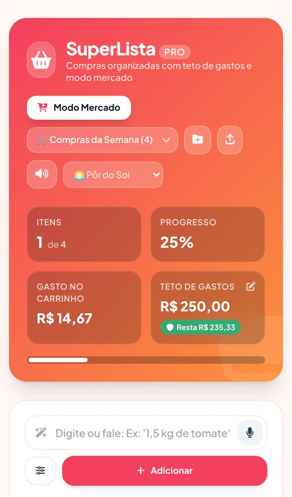 | 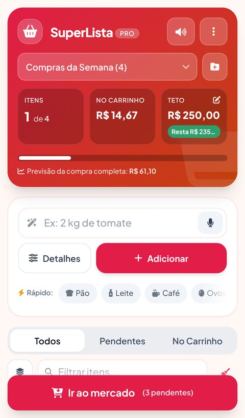 |

*Antes, o cabeçalho ocupava toda a primeira tela. Depois, já aparecem o campo de adicionar, as sugestões, os filtros e o botão "Ir ao mercado".*

#### Tema escuro no celular (bug corrigido)
| Antes | Depois |
|---|---|
| 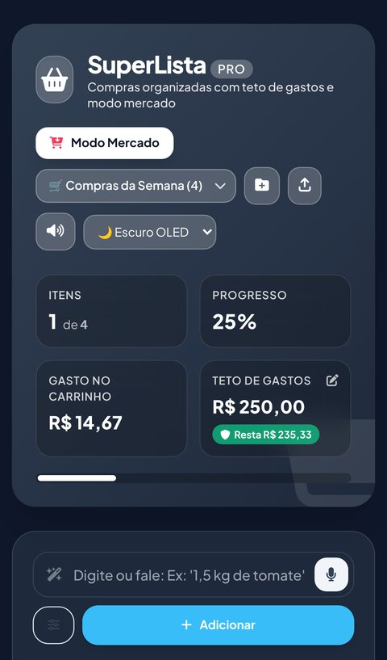 | 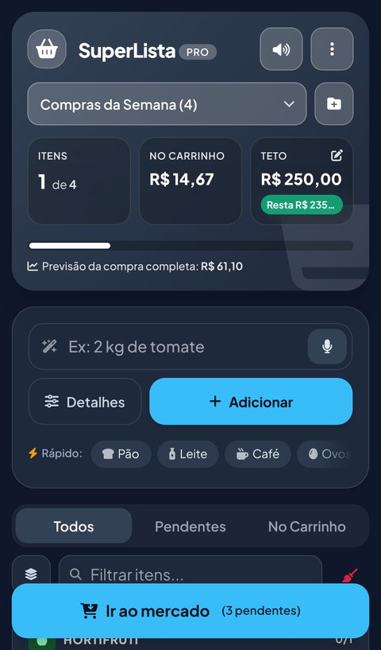 |

*Antes, os cards ficavam brancos e o nome dos itens sumia (texto branco no fundo branco).*

#### Modo Mercado
| Antes | Depois |
|---|---|
| 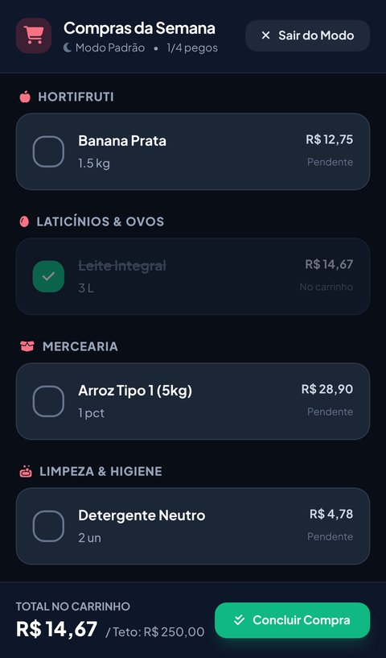 | 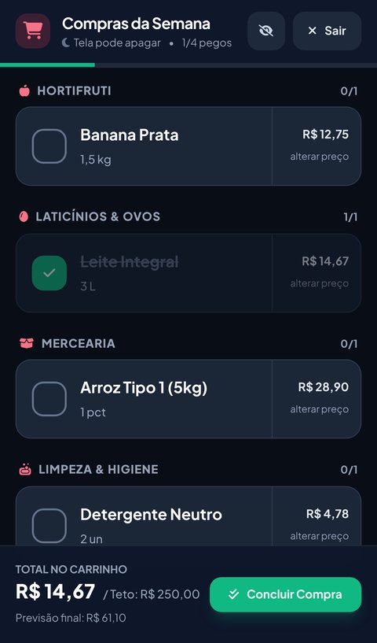 |

*Depois: pendentes primeiro, barra de progresso, botão para tocar no preço e informar o valor da etiqueta, e previsão do total final.*

#### Celular pequeno (320 px)
| Antes | Depois |
|---|---|
| 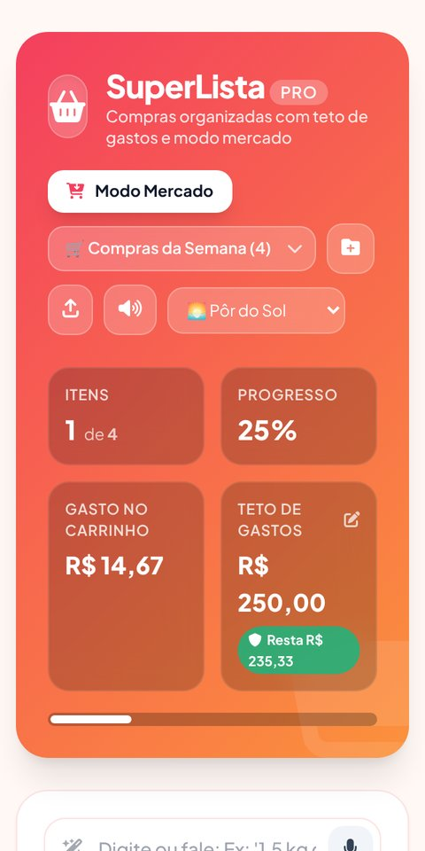 | 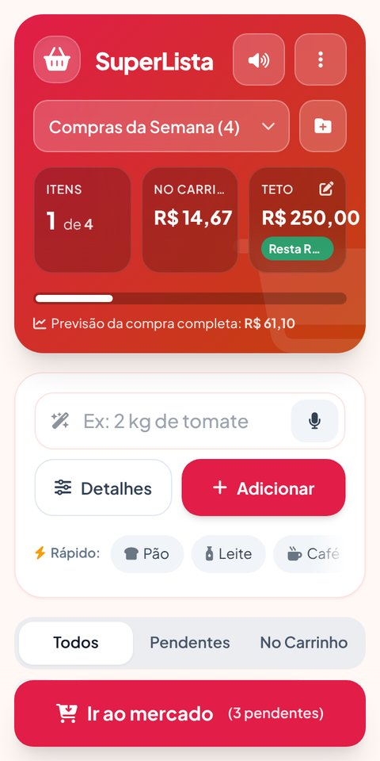 |

#### Página inteira no celular
| Antes | Depois |
|---|---|
| 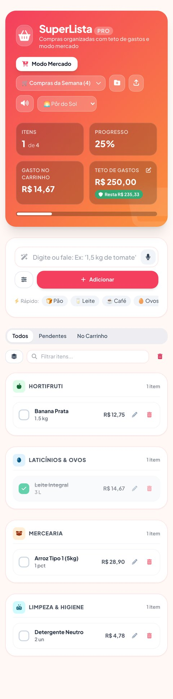 | 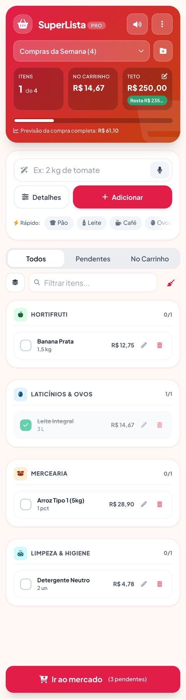 |

#### Tablet (768 px)
| Antes | Depois |
|---|---|
| 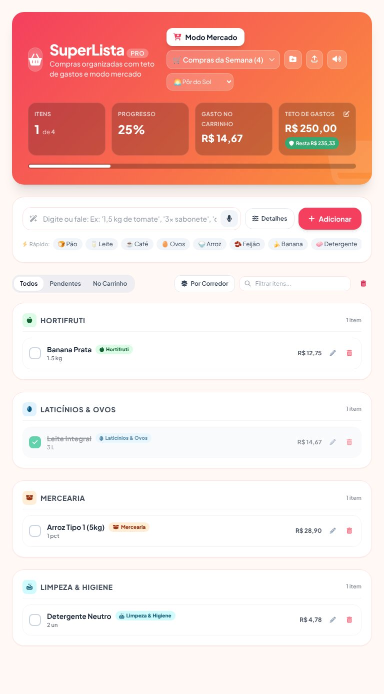 | 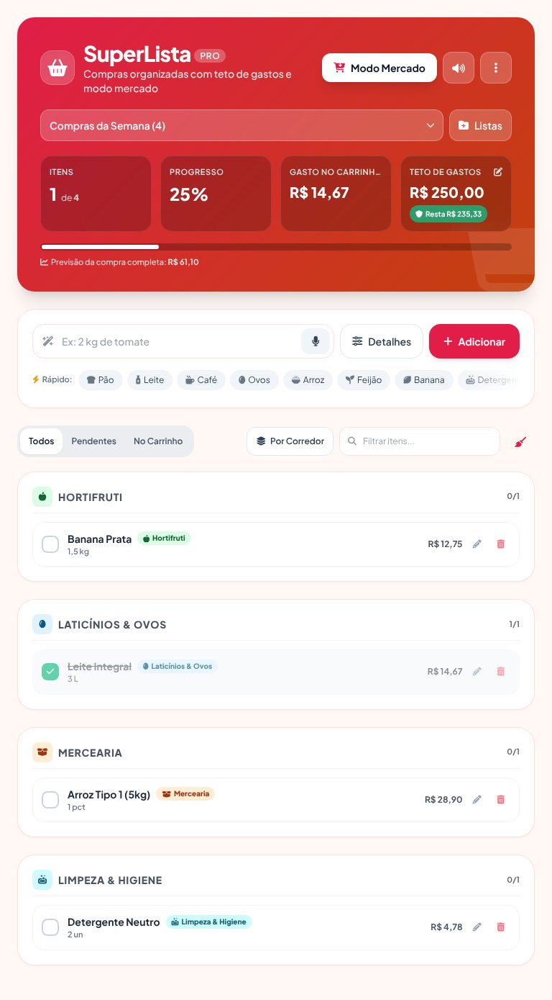 |

#### Desktop (1280 px)
**Antes**
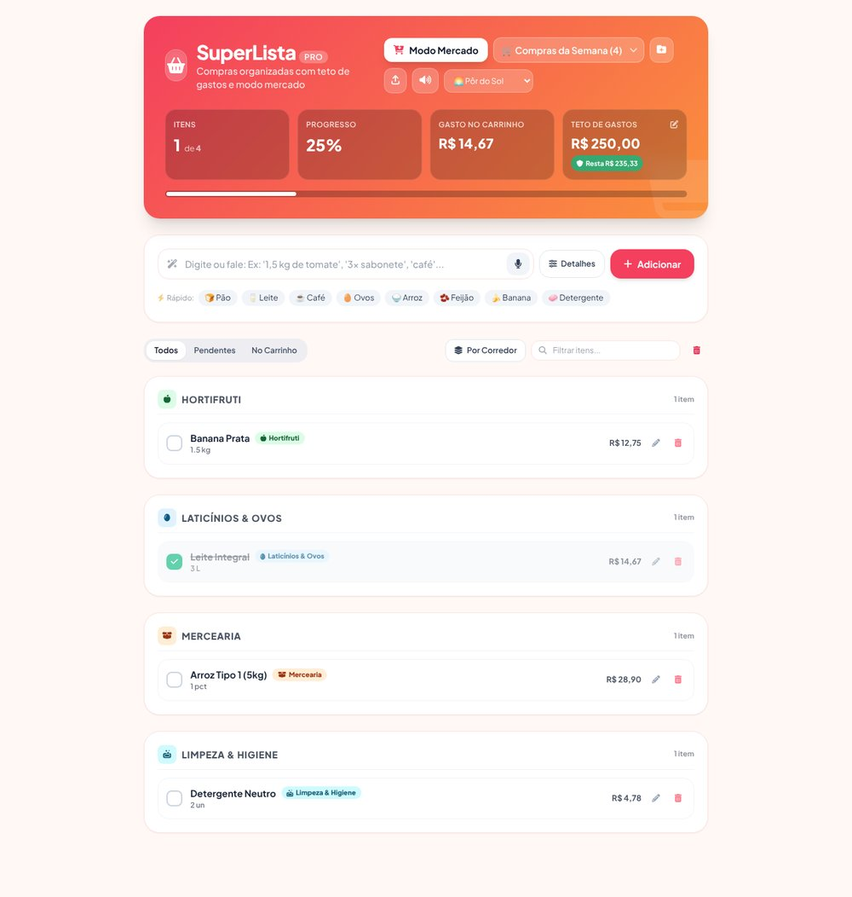

**Depois**
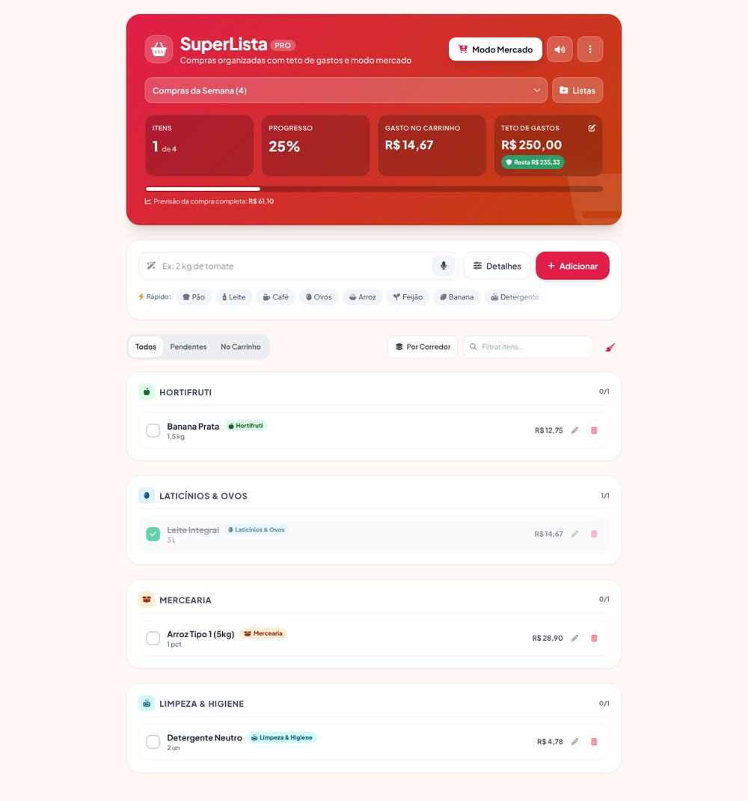

---

## Etapa 9 — Testes e validação

### 9.1 Como foi testado

Foram usadas duas camadas de testes automatizados, que ficam no repositório e podem ser rodadas por qualquer pessoa:

| Camada | Comando | O que cobre | Resultado |
|---|---|---|---|
| **Unitários** (Node.js Test Runner) | `npm test` | Parser de linguagem natural, cálculos de orçamento, listas, exportação CSV/WhatsApp, validação de backup | **22/22 ✔** |
| **Ponta a ponta** (Playwright, navegador real) | `npm run test:e2e` | Cada botão, formulário e fluxo da interface, 5 tamanhos de tela e modo offline | **35/35 ✔** |

**Prova de que os testes funcionam (teste de mutação):** três bugs foram introduzidos de propósito numa cópia do app. Em cada caso, exatamente o teste correspondente falhou:

| Bug introduzido de propósito | Teste que detectou |
|---|---|
| Remover o escape de HTML (volta o XSS) | ✘ "backup malicioso não executa código" |
| Tema escuro voltar a seguir o sistema | ✘ "temas: aplica, marca o selecionado e persiste" |
| Parar de validar o preço no Modo Mercado | ✘ "entrar, marcar, informar preço (com validação)…" |

### 9.2 Checklist pedido no enunciado

| Verificação | Como foi verificado | Resultado |
|---|---|---|
| **Todos os botões e elementos interativos funcionam** | 35 testes clicam em todos os botões: adicionar, voz, detalhes, chips, marcar, editar, excluir, desfazer, abas, visão, busca, limpar, teto, listas (criar/renomear/duplicar/trocar/excluir), WhatsApp, CSV, imprimir, backup (baixar/abrir/restaurar), temas, som, Modo Mercado (marcar, preço, ocultar, concluir, sair). Um teste também confere que **todo botão tem nome acessível** e que não há IDs duplicados. | ✔ |
| **Formulários recebem e validam as informações** | Campo vazio ou só com espaços não adiciona. Nome obrigatório ao editar e ao criar lista. Teto rejeita "abc" e aceita "100,50". Preço inválido no Modo Mercado mantém a janela aberta. JSON inválido no backup é recusado com mensagem. Backup malicioso é neutralizado. Valores com vírgula (padrão brasileiro) são aceitos em todos os campos de preço. | ✔ |
| **Erros durante a navegação** | Cada teste registra erros de JavaScript, `console.error`, requisições falhas e respostas HTTP ≥ 400. Nenhum ocorreu. Também verifica que **nenhum recurso externo** é carregado. | ✔ 0 erros |
| **Boa experiência de uso** | Sem rolagem horizontal em 320/390/412/768/1440 px. Botões principais com ≥ 40 px de altura. Navegação por teclado (`/`, `Tab`, `Enter`, `Esc`). App abre **offline** após a primeira visita. | ✔ |
| **Funciona nos navegadores** | Testado no **Chromium** (motor do Chrome, Edge, Opera, Samsung Internet) com perfis de desktop, Android (Pixel 7) e iPhone 13. O script aceita `BROWSER=firefox` e `BROWSER=webkit` (motor do Safari). | ✔ Chromium · ⚠ ver nota |

> **Nota honesta sobre navegadores:** o ambiente usado só tinha o Chromium instalado, então Firefox e Safari **não foram executados aqui**. O código usa apenas recursos padrão suportados por todos os navegadores modernos (ES Modules, `fetch`, `localStorage`, Service Worker, CSS Grid/Flexbox). Recursos que nem todo navegador tem (voz, Wake Lock e `navigator.share`) são detectados, e o app mostra uma alternativa em vez de quebrar. Para completar, rode na sua máquina:
> ```bash
> npx playwright install firefox webkit
> BROWSER=firefox npm run test:e2e
> BROWSER=webkit npm run test:e2e
> ```

### 9.3 Problemas encontrados durante os testes e soluções aplicadas

| Problema encontrado | Solução |
|---|---|
| Ao carregar a página sem acesso às CDNs: `ReferenceError: tailwind is not defined` e app sem estilo nem ícones | Tailwind compilado localmente e bibliotecas em `vendor/`; nenhuma dependência externa |
| Ícone do selo de orçamento aparecia mesmo com a classe `hidden`, fazendo o selo vazar do card em telas estreitas | O CSS do Font Awesome era carregado *depois* do Tailwind e sobrescrevia o `display`. A ordem dos arquivos foi invertida |
| Em 320 px, a aba "No Carrinho" quebrava em duas linhas e o selo "Resta R$ 235,33" saía do card | Texto adaptável por largura de tela, `whitespace-nowrap`, e reticências com o texto completo no `title` |
| Campo de busca com o atributo `type` duplicado (`type="text"` e `type="search"`) | Removido o duplicado; ficou `type="search"` (mostra o botão de limpar no celular) |
| Classe `bg-[var(--theme-accent-soft)]/40` não funcionava depois de compilar o Tailwind (opacidade sobre variável CSS) | Substituída por uma classe própria `.theme-accent-ring` no `style.css` |
| Confete disparava ao recarregar uma lista já completa | A celebração só ocorre na *transição* para 100%, dentro da mesma lista |
| Preço real em branco no formulário de edição virava R$ 0,00 | Em branco, agora vale o preço estimado |
| Texto de exemplo do campo de adicionar cortado no celular | Texto encurtado para "Ex: 2 kg de tomate" (a prévia do parser mostra o resto) |

---

## Etapa 10 — Publicação no GitHub Pages

### 10.1 Organização dos arquivos

```text
guilhermedevito/
├── index.html               # Página do app
├── manifest.webmanifest     # Instalação como app (PWA)
├── sw.js                    # Service Worker: funcionamento offline
├── .nojekyll                # Diz ao GitHub Pages para servir os arquivos como estão
├── css/
│   ├── tailwind.css         # Tailwind compilado (gerado por npm run build:css)
│   ├── tailwind.input.css   # Entrada do Tailwind
│   └── style.css            # Temas, tokens e estilos próprios
├── js/
│   ├── app.mjs              # Controlador da interface
│   ├── store.mjs            # Dados, listas, orçamento, exportações
│   ├── parser.mjs           # Linguagem natural e voz
│   ├── format.mjs           # Formatação pt-BR (R$, quantidades)
│   ├── ui.mjs               # Toast, confete, escape de HTML
│   └── audio.mjs            # Sons sintetizados
├── assets/icon.svg          # Ícone do app
├── vendor/                  # Font Awesome e fonte Plus Jakarta Sans (locais)
├── tests/                   # 22 testes unitários + 35 testes E2E
├── docs/                    # Este relatório, capturas, especificação e comparativo
├── package.json             # Scripts: build:css, test, test:e2e
└── tailwind.config.cjs
```

### 10.2 Passos realizados

1. **Repositório criado no GitHub:** `jao0097/guilhermedevito` (público).
2. **Arquivos enviados** com `git push`, preservando todo o histórico de commits do projeto.
3. **Publicação configurada** pela branch `gh-pages`, que o GitHub Pages publica automaticamente. Um arquivo `.nojekyll` garante que todas as pastas sejam servidas como estão.
4. **Endereço público:** **https://jao0097.github.io/guilhermedevito/**
5. **Teste do endereço público:** ver a seção 10.3.

### 10.3 Teste do endereço público

O app usa **apenas caminhos relativos** (`css/…`, `js/…`, `sw.js`), então funciona dentro da subpasta `/guilhermedevito/` do GitHub Pages sem ajustes. O status da publicação foi conferido pela API do GitHub (seção "Environments → github-pages" do repositório).

Para conferir pelo celular: abra o link, adicione um item, ative o modo avião e recarregue. O app continua funcionando. No Chrome do Android aparece a opção "Instalar app".

---

## Etapa 11 — Reflexão sobre o uso de Skills

> *Rascunho escrito a partir do que aconteceu de fato nesta atividade. Revise e ajuste com as suas próprias palavras e impressões antes de entregar.*

**O que você aprendeu sobre Skills para agentes de IA?**
Uma Skill é um "pacote de conhecimento" que o agente carrega quando a tarefa pede: instruções, checklists, padrões e exemplos escritos por alguém que domina o assunto. Ela não deixa o modelo mais inteligente. O que ela faz é deixá-lo **mais consistente**, porque ele passa a seguir um método em vez de improvisar. Ficou claro que a Skill vale tanto quanto o processo que ela descreve. A `frontend-ultra` funcionou porque tem fases claras e um checklist verificável ("funciona em 375 px?", "contraste ≥ 4,5:1?").

**Qual foi a maior dificuldade durante a atividade?**
Garantir que as melhorias funcionavam *de verdade*, e não só no papel. Alguns problemas só apareceram ao rodar o app num navegador em vários tamanhos de tela, como o ícone que vazava do card por causa da ordem dos arquivos CSS. Outra dificuldade foi o ambiente: as CDNs estavam bloqueadas, e isso acabou revelando que o app dependia demais delas. A falta de Firefox e Safari no ambiente também limitou os testes entre navegadores.

**Em quais momentos a Skill apresentou maior utilidade?**
Na **análise** e na **verificação**, mais do que na escrita do código. O checklist de responsividade e acessibilidade apontou problemas que passariam despercebidos (contraste, hierarquia de títulos, emojis como ícones). A pergunta "quem é a audiência?" levou à melhor decisão de UX: o botão "Ir ao mercado" fixo embaixo, ao alcance do polegar.

**Você acredita que as Skills podem modificar a maneira como os desenvolvedores trabalham?**
Sim. Elas permitem transformar o conhecimento de uma equipe (padrões de código, checklist de revisão, processo de deploy) em algo que o agente aplica sempre da mesma forma. O desenvolvedor passa a gastar menos tempo repetindo instruções e mais tempo decidindo e revisando. Mas o papel humano continua essencial: em um ponto, foi preciso decidir *não* seguir a Skill (fontes locais em vez do Google Fonts) porque o contexto do projeto pedia outra coisa.

**Quais cuidados um desenvolvedor deve ter ao instalar Skills de terceiros?**
- **Ler a Skill inteira antes de instalar.** Ela é um conjunto de instruções que o agente vai seguir e pode conter comandos para rodar scripts, baixar arquivos ou enviar dados para fora.
- Desconfiar de Skills que **executam scripts**, pedem credenciais, chaves de API ou acesso à rede sem necessidade clara.
- Verificar **quem é o autor**, se o código é aberto e se há histórico de atualizações.
- Testar primeiro num projeto de exemplo, e não direto no código da empresa.
- Lembrar que a Skill pode conter **informação desatualizada ou opinião**, e conferir as recomendações em vez de aceitar tudo.
- Revisar sempre o código que o agente gerou com a Skill, como se fosse o código de um colega.

**Você utilizaria essa Skill em um projeto profissional? Justifique.**
Sim, como **checklist de qualidade de interface**: as partes de responsividade, acessibilidade, estados vazios e de erro, e tokens de design são boas práticas reais. Usaria com ajustes. Por exemplo, a recomendação de sempre carregar fontes de CDN não serve para apps offline, e algumas regras estéticas ("escolha uma direção visual ousada") precisam respeitar o design system da empresa. Numa equipe, eu adaptaria a Skill aos padrões do time.

**Se pudesse criar sua própria Skill, qual seria sua finalidade?**
Uma Skill de **"publicação de projeto web para avaliação"**: organiza as pastas, remove dependências de CDN, roda testes de botões e formulários em vários tamanhos de tela, gera as capturas de tela de antes e depois, publica no GitHub Pages e monta este tipo de relatório. Foi exatamente o processo repetitivo desta atividade, e uma Skill faria com que ele fosse sempre completo e igual.
